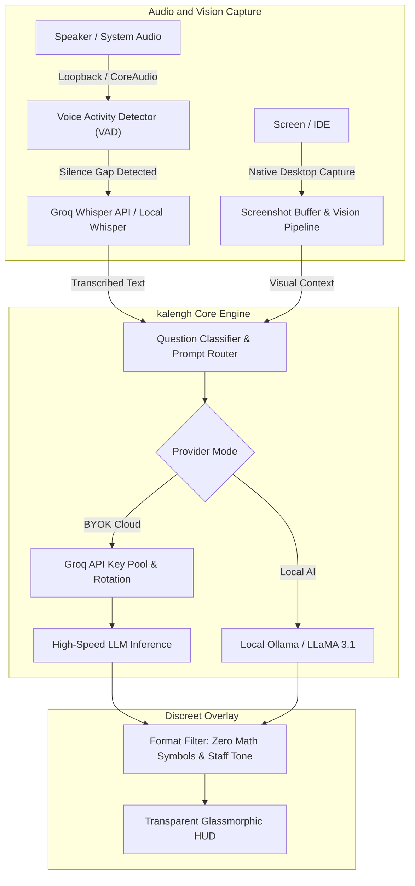

# kalengh ⚡
### Real-Time Audio & Visual AI Copilot for Engineers and Problem Solvers
**Engineered by [exhuzaifa (Huzaifa Malik)](https://exhuzaifa.vercel.app)**

[](LICENSE)
[](https://exhuzaifa.vercel.app)
[](https://www.linkedin.com/in/huzaifa-malikk/)
[](https://contra.com/huzaifa_malik)
[](https://github.com/Techsynx/kalengh)
[]()

---

## 💡 Overview

**kalengh** is an ultra-fast, discreet desktop AI assistant built on Electron, designed by **exhuzaifa** to provide contextual, sub-second intelligence during technical interviews, live coding sessions, and complex architectural discussions. 

Unlike standard AI chat interfaces, **kalengh** operates passively in the background:
- 🎙️ **Real-Time Speech Detection**: Hooks directly into incoming speaker audio via Voice Activity Detection (VAD) and Groq Whisper (`whisper-large-v3-turbo`) to transcribe questions the millisecond the speaker finishes.
- 👁️ **Multimodal Screen Capture**: Takes discreet snapshots of coding prompts, IDEs, or whiteboard diagrams without triggering browser screen-sharing banners.
- 🧠 **Staff-Level Reasoning**: Powered by ultra-fast LLMs (`openai/gpt-oss-120b`, `llama-3.3-70b-versatile`, or `gemini-2.5-flash-lite`) with structured coding rules that prioritize problem understanding, complexity derivations, and optimal implementations.
- 👻 **Discreet Click-Through HUD**: A floating glassmorphic window that can be rendered transparent, clicked through, or toggled with a single keystroke.
- 💻 **100% Local Mode Available**: Option to run completely offline on your own machine using **Ollama** and local Whisper models.

---

## 🛠️ Architecture & Working Mechanism



### Complete Pipeline
1. **Audio Interception**: On Windows, kalengh leverages loopback system capture to isolate speaker audio from user microphone audio. On macOS, it spawns a lightweight CoreAudio helper (`SystemAudioDump`).
2. **Dynamic Key Rotation**: Cloud mode utilizes a self-healing key pool. If a provider returns a 429 (rate-limit) or 401 error, kalengh automatically rotates to the next API key in milliseconds without dropping the session.
3. **Optimized Interview Persona**: The response engine strictly enforces concise, spoken-friendly answers without messy Markdown syntax or mathematical notation that cannot be vocalized naturally.

---

## 🚀 Getting Started & Installation

### Option 1: Pre-Built Installers

* **Windows**: Download `kalengh-1.0.1 Setup.exe` from the [Latest Releases](https://github.com/Techsynx/kalengh/releases) and double-click to install.
* **macOS**: Download `kalengh-1.0.1-arm64.dmg` from Releases. Drag it into your Applications folder.
  > **Note for macOS:** On first launch, open **System Settings > Privacy & Security > Screen Recording** (and Microphone) and enable permissions for **kalengh**.
* **Linux**: Download the `.deb` or `.AppImage` package. Make it executable and launch.

---

### Option 2: Running & Building from Source

Ensure you have [Node.js](https://nodejs.org) (v18 or higher) and `npm` installed.

1. **Clone the repository**:
   ```bash
   git clone https://github.com/Techsynx/kalengh.git
   cd kalengh
   ```

2. **Install dependencies**:
   ```bash
   npm install
   ```

3. **Start the development application**:
   ```bash
   npm start
   ```

4. **Package distributable installers**:
   ```bash
   # Generates .exe on Windows, .dmg on macOS, or .AppImage on Linux
   npm run make
   ```
   Artifacts are output to the `out/make` directory.

---

## 🔑 API Keys & Configuration

kalengh is completely free and open-source. It supports two operation modes:

### 1. Bring Your Own Key (BYOK) Mode
* **Gemini API Key** *(Required for vision and multimodal analysis)*:
  Get a free API key at [Google AI Studio](https://aistudio.google.com/apikey).
* **Groq API Key** *(Recommended for sub-second Whisper audio transcription & LLM speed)*:
  Get a free API key at [Groq Console](https://console.groq.com/keys). You can provide comma-separated keys for automatic round-robin rotation.

### 2. Local AI Mode (100% Offline)
* Run models entirely on your own GPU/CPU with [Ollama](https://ollama.ai).
* Set your Ollama Host (default `http://127.0.0.1:11434`) and choose models like `llama3.1` or `qwen2.5-coder`.

---

## ⌨️ Default Keyboard Shortcuts

| Shortcut (Windows/Linux) | Shortcut (macOS) | Action |
| :--- | :--- | :--- |
| `Ctrl + \` | `Cmd + \` | **Toggle HUD Visibility** (Instantly show/hide) |
| `Ctrl + M` | `Cmd + M` | **Toggle Click-Through** (Interact with background windows) |
| `Ctrl + Enter` | `Cmd + Enter` | **Submit / Trigger Next Step** |
| `Ctrl + Up / Down` | `Alt + Up / Down` | **Move HUD Window** |
| `Ctrl + [ / ]` | `Cmd + [ / ]` | **Navigate Previous / Next Response** |
| `Ctrl + Shift + Up / Down`| `Cmd + Shift + Up / Down` | **Scroll Response** |

---

## 👨‍💻 Author & Creator

**kalengh** was conceived, architected, and engineered by **exhuzaifa (Huzaifa Malik)**.

* 🌐 **Portfolio**: [exhuzaifa.vercel.app](https://exhuzaifa.vercel.app)
* 💼 **LinkedIn**: [linkedin.com/in/huzaifa-malikk](https://www.linkedin.com/in/huzaifa-malikk/)
* ⚡ **Contra**: [contra.com/huzaifa_malik](https://contra.com/huzaifa_malik)
* 🐙 **GitHub**: [@Techsynx](https://github.com/Techsynx) / [@exhuzaifa](https://github.com/exhuzaifa)
* ✍️ **Dev.to**: [@exhuzaifa](https://dev.to/exhuzaifa)
* 📧 **Contact**: [exhuzaifa@gmail.com](mailto:exhuzaifa@gmail.com)

If you find **kalengh** helpful or inspiring, please give the repository a ⭐ star!

---

## 📄 License

This project is licensed under the **MIT License** — see the [LICENSE](LICENSE) file for details.  
Copyright (c) 2026 **exhuzaifa (Huzaifa Malik)**.
